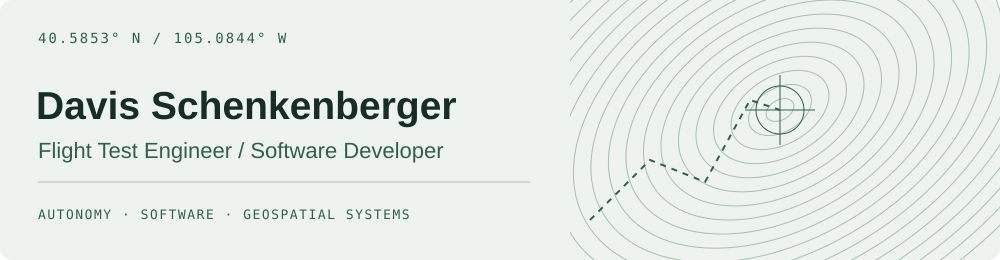

<picture>
  <source media="(prefers-color-scheme: dark)" srcset="./assets/banner-dark.svg">
  <source media="(prefers-color-scheme: light)" srcset="./assets/banner-light.svg">
  
</picture>

## Building software for the physical world.

I'm a flight test engineer and software developer based in Colorado. I'm interested in how software interacts with real-world systems — from developing tools and automating workflows to testing autonomous aircraft and making sense of geospatial data.

I enjoy building things that bridge the gap between code and hardware, with a particular interest in reliability, automation, and solving practical engineering problems.

[Website](https://schenkenberger.dev) · [Contact](mailto:davisschenk@gmail.com)

## Areas of interest

| Domain | Focus |
| :--- | :--- |
| Flight testing & autonomy | UAVs, system validation, test automation, telemetry, MAVLink |
| Software engineering | Rust, Python, developer tooling, backend systems |
| Geospatial technology | GIS, remote sensing, mapping, spatial data processing |
| Infrastructure & automation | Homelab, Linux, self-hosting, containers, integrations |

## Away from the keyboard

When I'm not testing aircraft or writing software, you'll probably find me in the Colorado mountains, brewing beer, hanging out with my dog Hazy, or unnecessarily automating another part of my life.
